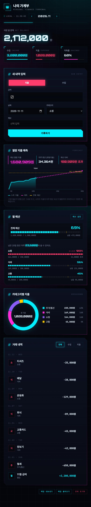

# 나의 가계부 (money-ledger)

DB도, 회원가입도 필요 없는 **파일 하나짜리 가계부 웹페이지**입니다.
`index.html`을 브라우저로 열기만 하면 바로 쓸 수 있습니다.

## 주요 기능

- **수입/지출 기록**: 날짜, 카테고리, 금액, 메모를 입력합니다. 금액에는 천 단위 쉼표가 자동으로 붙습니다.
- **월별 요약**: 잔액, 수입, 지출, 저축률을 보여줍니다.
- **월 예산과 경고 게이지**: 전체 예산과 카테고리별 예산을 설정할 수 있습니다.
  - 80%를 넘으면 주의, 100%를 넘으면 경고 알림을 띄웁니다.
  - 남은 날짜 기준으로 하루에 쓸 수 있는 금액을 알려줍니다.
- **월말 지출 예측**: 지금 소비 속도로 계산한 월말 예상 지출과 누적 추이 차트를 보여줍니다. 고정지출은 따로 계산합니다.
- **카테고리별 지출**: 도넛 차트로 보여줍니다.
- **거래 내역**: 날짜별로 묶어 보여주고 수입/지출로 걸러 볼 수 있습니다.
- **백업과 복원**: JSON 파일로 내보내고 다시 불러올 수 있습니다.

## 사용 방법

1. `index.html`을 내려받습니다.
2. 브라우저(Chrome, Edge 등)로 엽니다.

## 데이터 저장

- 모든 데이터는 **브라우저의 localStorage**에만 저장되고, 서버로는 전송되지 않습니다.
- 다른 브라우저나 기기로 옮길 때는 **백업 내보내기 → 백업 불러오기**를 사용하세요.

## 기술

HTML, CSS, 순수 JavaScript로 만들었습니다(외부 라이브러리 없음). 글꼴은 Pretendard, Orbitron, JetBrains Mono를 씁니다.
